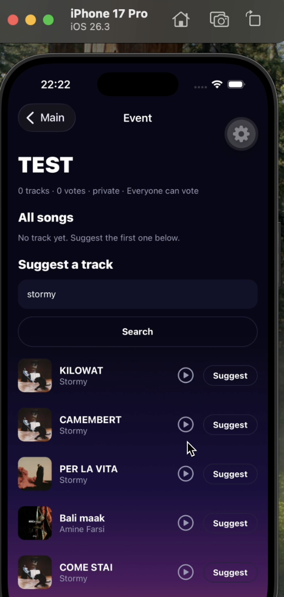

# Music Room

Music Room is a collaborative music app for sharing music with friends. Discover
tracks through the Deezer catalog, build playlists, and create events where
participants can suggest songs and vote on what to play. The app also includes
user profiles, friendships, invitations, and delegated device control.

Built with Expo and React Native for the mobile app and FastAPI with PostgreSQL
for the backend, Music Room brings music discovery and group listening into one
place.

## Demo

The screenshot below shows a demo of the event screen, where participants can
search for tracks, preview them, and suggest songs for the group.

## Getting started

- `backend/`: FastAPI/PostgreSQL auth, profiles, friendships, Deezer catalog, playlists, events/votes and delegated device control.
- `mobile/`: Expo React Native app.

Run `make install` once, then `make help` to see the commands. Plain `make`
shows help and does not start services.

Keep `make backend` running in terminal 1 (API and email worker). In terminal 2,
use `make phone` for Expo Go on a real phone (same Wi-Fi), or `make android` / `make ios` to open the installed development app without
rebuilding. First install it with `make android-build` or `make ios-build`; rebuild
only after changing native dependencies/configuration. Google login requires
this development app, not Expo Go.

Use `make web` for the browser frontend at http://localhost:8081. To explicitly
start both browser and backend together, use `make dev`; Ctrl+C stops them and
keeps the database. Never start another Metro/build command on the same port.
The API listens on port 8001: http://localhost:8001/docs.

Backend feature code is separated into `backend/mandatory/` and `backend/bonus/`;
`backend/app/` holds shared infrastructure. See [bonus setup and validation](backend/bonus/README.md)
for demo Free/Premium plans, offline playlist synchronization, nearby-event notifications,
and the optional speaker client. Run `make install` after updating to this layout,
then restart `make backend` to apply the new database migrations.

Copy `backend/.env.example` to `backend/.env` and `mobile/.env.example` to
`mobile/.env` when setting up a fresh clone. Never commit credentials.
Set the mobile API URL to your computer's LAN IP on port 8001 and turn mock mode off.
Saved in-app Backend settings override environment defaults.

Run `make typecheck` for the frontend and `make test-backend` for backend tests.
See [backend setup](backend/README.md) and [mobile setup](mobile/README.md).

The React Native/Expo frontend is integrated with the whole backend: authentication, profiles, Google,
friends, Deezer search, playlists, events/votes, invitations, device delegation and WebSocket invalidations.
Set `mobile` Settings > "Use mock data" off to use the real API; mock mode is a demo server with the same rules.
`make test-mobile` runs the app's unit tests; with the API running, `cd mobile && npm run test:integration`
exercises the real HTTP client end to end. See [mobile README](mobile/README.md) and
[API mapping](mobile/docs/API_MAPPING.md); backend details are in [music API handoff](backend/docs/MUSIC_INTEGRATION.md).
The local ignored backend `.env` sets `COMPOSE_PROJECT_NAME=backend` to preserve
this machine's existing development database.

- `make clean`: stop services and remove caches and test reports; keep database data.
- `make fclean`: do everything in `clean`, then delete this Compose project's containers,
  database volumes (all accounts and other stored data), and generated development emails.

Both commands preserve source files, installed dependencies, and `.env` credentials.
After `make fclean`, run `make backend` to create a fresh database and apply migrations.

Verification and reset messages are always saved locally. Set
`MAIL_DIRECTORY=.dev-mail` in `backend/.env`, then restart `make backend`. Register or resend
verification, open the newest `backend/.dev-mail/*.eml` file, and copy the value
after `Token:` into the app's Verify email screen. No email is sent to an inbox.

Run the three-service HTTP/WebSocket benchmark independently: [load-testing guide](backend/docs/LOAD_TESTING.md).
